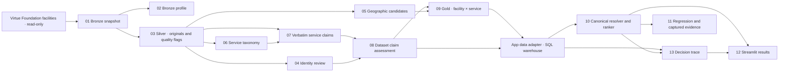

# CareProof architecture

Bronze preserves the Marketplace rows. Silver adds cleaned fields, parsed arrays and quality flags while retaining original text. Identity and geographic stages flag branch conflicts and incomplete addresses. A bounding-box pass establishes coordinate plausibility. A recorded PIN match compares text, with no postal lookup installed.

Claims carry exact excerpts, source record IDs and source content IDs. Gold selects a representative row per facility and service and prioritizes conflicting or rejected evidence. The verification table retains the broader claim set for detail. URLs are record-level leads.

The app reads service-scoped Gold rows and a cross-service address lookup. The ranker screens evidence, attribution and geography before calculating evidence-field, address consistency and, when applicable, great-circle proximity points. Equal scores use facility ID order. The decision trace reuses the exact citations and score components supplied to the results page.

Databricks Apps supplies the service principal. The app reads the warehouse, Gold index and verified claims. The validation operator reads Bronze for lineage reconciliation.
