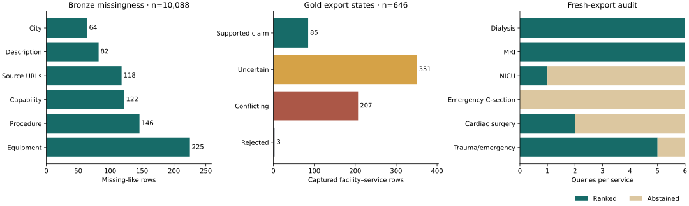

# Exploratory data analysis

The panels use three units. The first covers the **10,088-row, 51-column Bronze profile**. The second covers the **646-row archived Gold export**, which contains indexed services in six selected cities and a stratified capture outside them. The third covers **36 fixed service/city searches** on a refreshed Databricks export. These targeted slices cannot estimate rates for the full index or patient searches.

| Bronze signal | Count | Share of 10,088 |
| --- | ---: | ---: |
| City missing-like | 64 | 0.63% |
| Description missing-like | 82 | 0.81% |
| Capability missing-like | 122 | 1.21% |
| Procedure missing-like | 146 | 1.45% |
| Equipment missing-like | 225 | 2.23% |
| Source URLs missing-like | 118 | 1.17% |
| Coordinate pairs missing | 118 | 1.17% |
| Coordinate pairs outside approximate India bounds | 6 | 0.06% |
| Invalid PIN | 256 | 2.54% |

Missing-like includes SQL NULL, blanks and documented placeholder literals. The profile counted 11 excess rows sharing populated IDs and 9,964 coordinate pairs within the approximate India bounds. The latter cannot validate a city or branch. In the 646-row Gold capture, 101 facility–service rows had a possible administrative conflict, 11 had unresolved geography and seven had a point outside the approximate India bounds. Signals can overlap and facilities can repeat across services.

## Evidence and attribution

The archived Stage 08 gate measured **13,033 assessed claims**. Stage 09 measured **5,261 Gold facility–service rows**. The 646-row export contains a representative assessment per facility and service. It includes **497 mentions**, **135 candidate claims**, **11 uncertain extractions** and **3 explicit negations**.

Of those 646 rows, **85 (13.16%)** had automated support as attributable dataset text, **351** were uncertain, **207** conflicting and **3** rejected. The export recorded 207 rows flagged for text mentioning another facility or branch and 278 with mention-without-offering as the assessment reason. These flags have no manually adjudicated population error rate.

Capability contributed 409 selected claims, procedure 147, equipment 78, description 11 and specialties one. All 646 rows had unverified record-level URL leads. The archived evidence establishes zero independently confirmed claims about current service availability.

| Service | Supported / captured Gold rows | Ranked / 6 searches | Ranked placements | Review placements |
| --- | ---: | ---: | ---: | ---: |
| Dialysis | 27/128 | 6/6 | 17 | 91 |
| MRI | 28/130 | 6/6 | 26 | 93 |
| NICU | 8/98 | 1/6 | 2 | 82 |
| Emergency C-section | 1/5 | 0/6 | 0 | 0 |
| Cardiac surgery | 9/56 | 2/6 | 4 | 33 |
| Trauma and emergency care | 12/229 | 5/6 | 8 | 213 |

The dialysis and emergency C-section contrast reflects indexed evidence within these searches. It cannot establish which services are present in those cities. Placements count results across searches and may repeat facilities.

Run `python -m careproof.report13` with Matplotlib to reproduce the figure and [metrics JSON](stage13_metrics.json), which includes input hashes. Sources [Bronze profile](02_profile.json), [Stage 08 gate](gate_08.json), [Stage 09 gate](gate_09.json), [capture](real_data_capture.json), [fresh-export audit](location_resolution_live_before_after.json).
